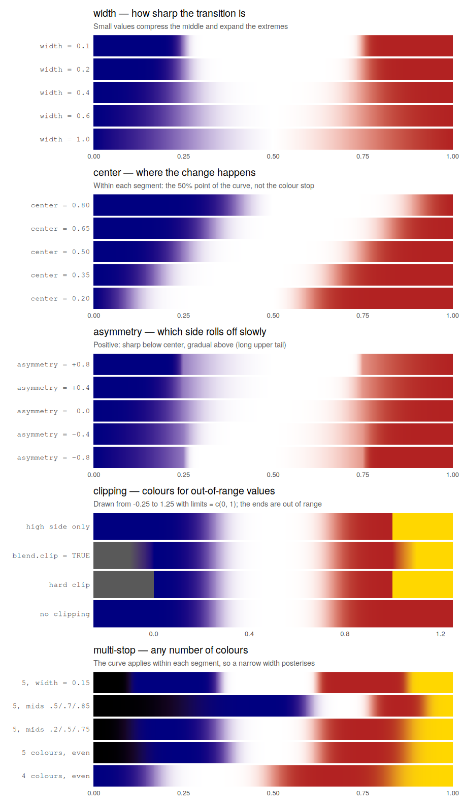
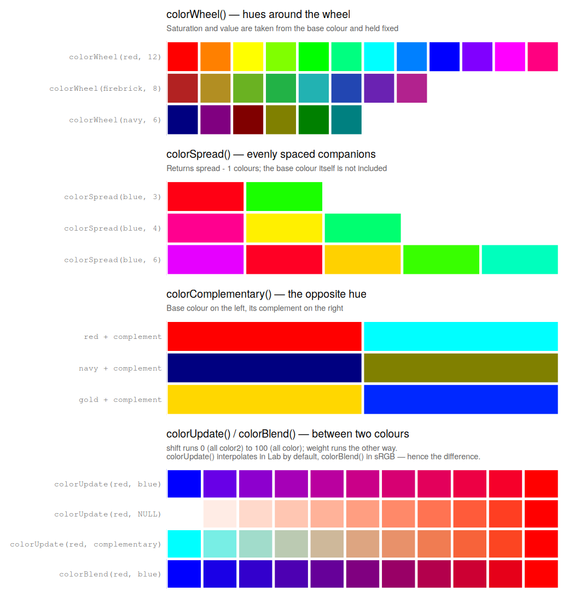
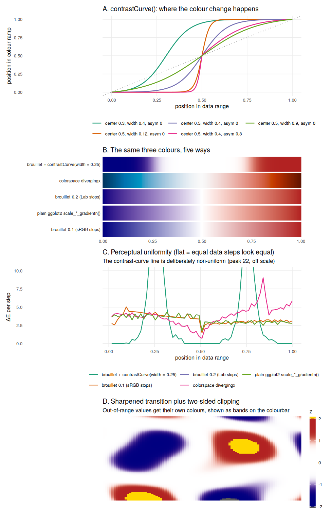

# brouillet

Colour manipulation tools for R: build a gradient specification once, control
where along the data range the colour change happens, and convert the same
object into a ggplot2 scale, a value-to-colour function, or a table of stops.

```r
library(brouillet)

p <- gradientParams(
  colors    = c("navy", "white", "firebrick"),
  midpoints = 0.5,   # where the middle colour sits, as a fraction of the range
  center    = 0.5,   # where the colour change is fastest
  width     = 0.3    # how much of the range the change spans
)

asColorFun(p, limits = c(-2, 2))(c(-2, 0, 2))
#> "#000080" "#FFFFFF" "#B22222"
```

---

## Contents

1. [Install](#install)
2. [Concepts](#concepts)
3. [Building a specification](#building-a-specification) — `gradientParams`, `gradientTemplate`, `withColors`, `updateGradient`, `reverseGradient`
4. [Controlling the curve](#controlling-the-curve) — `contrastCurve`
5. [Clipping](#clipping)
6. [Multi-stop gradients](#multi-stop-gradients)
7. [Manual curves](#manual-curves)
8. [Using a specification](#using-a-specification) — `asColorFun`, `asScaleFillGradient`, `asScaleColorGradient`, `buildGradient`, `previewGradient`
9. [Direct builders](#direct-builders) — `sigmoidGradient2/3/n`, `linearGradient2/n`, `customGradientFun`
10. [Clipping builders](#clipping-builders) — `clippingGradient`, `blendingClippingGradient`
11. [Colour helpers](#colour-helpers) — `isColor`, `colorWheel`, `colorComplementary`, `colorSpread`, `colorBlend`, `colorUpdate`
12. [Helpers](#helpers) — `relativeMidpoint`
13. [Integration](#integration)
14. [Known limitations](#known-limitations)

---

## Install

```r
devtools::install("brouillet", build_vignettes = TRUE)
devtools::test("brouillet")     # 317 expectations

vignette("brouillet")           # Getting started
```

**OR**

```r
install.packages("remotes")     # Install remotes if you don't have it
remotes::install_github("SimonBourdareau/brouillet", build_vignettes = TRUE)
```

## Install from GitHub with vignettes


Imports `ggplot2`, `scales`, `rlang`, `grDevices`, `stats`. Built and checked
against R 4.3.3, ggplot2 3.4.4, scales 1.3.0.

All exported functions are camelCase. S3 class strings (`brouillet_gradient_params`,
`brouillet_gradient_template`, `brouillet_color_fun`) are not, so `inherits()`
checks read naturally.

---

## Concepts

A gradient is described **once**, independently of any plot. Nothing in a
specification refers to your data, so the same object works on `c(-2, 2)` and on
`c(0, 100)`.

Two coordinates matter, and they are different things:

* **`midpoints`** place the *colour stops*: where `white` sits between `navy`
  and `firebrick`. Always fractions in `(0, 1)`, never data values.
* **`center` / `width` / `asymmetry`** shape the *curve within each segment*:
  how fast the colour changes as you move through it.

Colours are interpolated in CIE Lab by default, which is what
`ggplot2::scale_fill_gradientn()` does internally; brouillet delegates to the
same function, so the two agree exactly.

---

## Building a specification

### `gradientParams(colors, midpoints, center, width, asymmetry, resolution, space, interpolate, rescale, low.clip.color, high.clip.color, blend.clip, gradient.mode, mapping.fun)`

The main constructor. Returns a `brouillet_gradient_params` object.

```r
p <- gradientParams(c("navy", "white", "firebrick"), midpoints = 0.5, width = 0.3)
p
#> <brouillet gradient>
#>  mode:       sigmoid
#>  colors:     navy -> white -> firebrick
#>  space:      Lab (linear)
#>  resolution: 100
#>  midpoints:  0.5
#>  curve:      center 0.5, width 0.3
```

| Argument | Default | Meaning |
|---|---|---|
| `colors` | — | Two or more colours. Colour `i` runs to colour `i + 1` as the value increases. |
| `midpoints` | evenly spaced | Interior stops as fractions in `(0, 1)`; length `length(colors) - 2`. |
| `center` | `0.5` | Curve 50% point. |
| `width` | `0.4` (`1` for linear) | Curve 5–95% span. |
| `asymmetry` | `0` | −1 to 1; which side rolls off slowly. |
| `steepness.preset` | `NULL` | Named shorthand for the three above, from `steepnessPresets()`. Explicit values override it. |
| `resolution` | `100` | Number of stops when sampling. |
| `space` | `"Lab"` | `"Lab"` (perceptual) or `"sRGB"`. |
| `interpolate` | `"linear"` | `"linear"` or `"spline"`. |
| `rescale` | mode-dependent | Force the end colours to be reached exactly. |
| `low.clip.color`, `high.clip.color` | `NULL` | Colours for out-of-range values. |
| `blend.clip` | `FALSE` | Fade clip colours in rather than switching. |
| `gradient.mode` | `"sigmoid"` | `"sigmoid"`, `"linear"` or `"custom"`. |
| `mapping.fun` | `NULL` | Required for `"custom"`. |

### `gradientTemplate(...)`

The same arguments **without** `colors`: a reusable shape, to be given a palette
later. Use it when the curve and clipping are a house style but the colours vary
per plot.

```r
tmpl <- gradientTemplate(width = 0.2, high.clip.color = "gold")
tmpl
#> <brouillet gradient template>  (no colours yet)
#>  mode:       sigmoid
#>  space:      Lab (linear)
#>  curve:      center 0.5, width 0.2
#>  clipping:   none | gold
#>  complete it with withColors(x, colors)
```

### `withColors(x, colors, midpoints)`

Gives a template (or replaces the palette of a specification) its colours,
returning a complete `brouillet_gradient_params`.

```r
p <- withColors(tmpl, c("navy", "white", "firebrick"), midpoints = 0.4)
p$width       #> 0.2   (kept from the template)
p$midpoints   #> 0.4

withColors(p, c("black", "white"))$colors    #> "black" "white"
```

### `updateGradient(params, ...)`

Replaces any field and revalidates the result. `NULL` resets a field to its
default. Changing the palette length drops stale `midpoints` with a warning.

```r
updateGradient(p, width = 0.1)                   # sharpen
updateGradient(p, high.clip.color = NULL)        # reset a field
updateGradient(p, colors = c("navy", "red"))     # warns: midpoints dropped
updateGradient(p, widht = 0.1)                   # Error: Unknown gradient field(s): widht
```

Never assign into a specification directly (`p$colors <- ...`); that bypasses
validation and fails later, somewhere less helpful.

### `reverseGradient(params)`

Mirrors a specification: colours, midpoints, curve centre, asymmetry and clip
colours all flip, so the result is the mirror image rather than just the colours
in reverse order.

```r
r <- reverseGradient(gradientParams(c("navy", "white", "firebrick"),
                                    midpoints = 0.4, center = 0.3))
r$colors      #> "firebrick" "white" "navy"
r$midpoints   #> 0.6
r$center      #> 0.7
```

---

## Controlling the curve



### `contrastCurve(x, center, width, asymmetry, rescale)`

The S-shaped mapping from position-in-data to position-in-ramp. Exported so you
can inspect or reuse it; the gradient functions apply it for you.

```r
x <- seq(0, 1, length.out = 20001)
y <- contrastCurve(x, center = 0.7, width = 0.2)

x[which(y >= 0.5)[1]]                             # the 50% point
#> 0.7
x[which(y >= 0.95)[1]] - x[which(y >= 0.05)[1]]   # the 5-95% span
#> 0.19995
```

| Argument | What it does |
|---|---|
| `center` | Position of the 50% point, in `[0, 1]`. The colour change is fastest here. |
| `width` | Span over which the curve goes 5% → 95%. `0.1` is nearly a threshold, `1` nearly linear, above `1` flattens further. |
| `asymmetry` | −1 to 1. Positive: sharp below `center`, gradual above (long upper tail). Negative: the reverse. |
| `rescale` | Guarantees the end colours are reached exactly. `TRUE` for sigmoid and custom, `FALSE` for linear. |

`width` is exact while the transition fits inside the range; above about
`width = 0.5` rescaling clips the tails and the measured span comes out
slightly narrower (`0.6` measures `0.573`).

Typical settings:

```r
# Emphasise a narrow band of high values, compress everything below
gradientParams(c("grey95", "firebrick"), center = 0.75, width = 0.15)

# Diverging, sharp turn either side of the centre
gradientParams(c("navy", "white", "firebrick"), midpoints = 0.5, width = 0.25)

# Long upper tail: threshold at the bottom, slow ramp above
gradientParams(c("white", "darkgreen"), center = 0.3, width = 0.4, asymmetry = 0.8)

# No curve at all
gradientParams(c("navy", "firebrick"), gradient.mode = "linear")
```

`gradient.mode = "linear"` uses the same vocabulary with straight lines:
`width = 1` is an ordinary ramp, `width < 1` leaves flat regions at both ends.

---

## Clipping

Values outside `limits` can take their own colours, shown as bands on the
colourbar — the part ggplot2 does not do out of the box.

```r
p <- gradientParams(c("navy", "white", "firebrick"), midpoints = 0.5, width = 0.3,
                    low.clip.color = "grey35", high.clip.color = "gold")

asColorFun(p, limits = c(-2, 2))(c(-99, -2, 0, 2, 99, NA))
#> "grey35" "#000080" "#FFFFFF" "#B22222" "gold" "grey95"
```

* **One side is enough**: set only `high.clip.color` and the low end keeps the
  gradient's own first colour.
* **`blend.clip = TRUE`** fades the clip colour in over the first 10% of the
  range beyond each limit, identically through `asColorFun()` and the scales.
* **The scales squish**: `asScaleFillGradient()` defaults to
  `oob = scales::oob_squish`, so a value at 10× the limit still gets the clip
  colour instead of `na.value`. Pass your own `oob =` to override.
* **Do not pre-squish your data.** Clamping values into range before plotting
  means nothing is ever out of range, so the clip colours can never fire:

```r
raw      <- c(-0.4, 0, 0.5, 1, 1.4)
squished <- scales::oob_squish_any(raw, range = c(0, 1))

f <- asColorFun(gradientParams(c("white", "red"), low.clip.color = "grey30",
                               high.clip.color = "gold"))
f(raw)        #> "grey30"  "#FFFFFF" "#FF9E81" "#FF0000" "gold"
f(squished)   #> "#FFFFFF" "#FFFFFF" "#FF9E81" "#FF0000" "#FF0000"
```

---

## Multi-stop gradients

Any number of colours, with `length(colors) - 2` interior stops.

```r
p <- gradientParams(c("black", "navy", "white", "firebrick", "gold"),
                    midpoints = c(0.2, 0.5, 0.75), width = 0.3)

asColorFun(p, limits = c(0, 100))(c(0, 20, 50, 75, 100))
#> "#000000" "#000080" "#FFFFFF" "#B22222" "#FFD700"
```

Stops land at `limits[1] + midpoints * span`. Omit `midpoints` and they are
spaced evenly.

**The curve applies within each segment, not across the whole ramp.** With many
stops a narrow `width` sharpens *each* transition, posterising the gradient into
bands. If you want one contrast curve across the whole range, use two or three
colours; if you want banding, this is how to get it.

---

## Manual curves

Any vectorised, non-decreasing function from `[0, 1]` to `[0, 1]`.

```r
gradientParams(c("white", "navy"), gradient.mode = "custom", mapping.fun = sqrt)

gradientParams(c("white", "navy"), gradient.mode = "custom",
               mapping.fun = function(x) x^2.2)                  # gamma

gradientParams(c("white", "navy"), gradient.mode = "custom",
               mapping.fun = function(x) floor(x * 4) / 4)       # four bands
```

Histogram equalisation — every quantile gets an equal share of the colour range,
so colours track the distribution rather than the raw scale:

```r
equalise <- function(values, limits) {
  f <- stats::ecdf(values)
  lo <- f(limits[1]); hi <- f(limits[2])
  function(x) {
    y <- f(limits[1] + x * (limits[2] - limits[1]))
    if (hi > lo) (y - lo) / (hi - lo) else y
  }
}

z <- rlnorm(5000)
lims <- c(0, unname(quantile(z, 0.99)))
p <- gradientParams(c("white", "navy"), gradient.mode = "custom",
                    mapping.fun = equalise(z, lims))
```

Checked when the specification is built, not at plot time: vectorised, same
length out as in, within `[0, 1]`, non-decreasing. In custom mode the colours
are one ramp, not per-segment, so `midpoints` do not apply.

---

## Using a specification

### `asColorFun(params, limits, na.color)`

A vectorised value → colour function, interface-compatible with
`circlize::colorRamp2()`.

```r
col_fun <- asColorFun(p, limits = c(-2, 2), na.color = "grey90")

col_fun(c(-2, 0, 2))
#> "#000080" "#FFFFFF" "#B22222"

ComplexHeatmap::Heatmap(mat, col = col_fun)
image(volcano, col = col_fun(seq(90, 200, length.out = 64)))
```

### `asScaleFillGradient(params, limits, na.value, guide, show.clip, clip.width, ...)`

### `asScaleColorGradient(...)`

ggplot2 scales. `...` passes through to `scale_fill_gradientn()` /
`scale_color_gradientn()`.

```r
ggplot(df, aes(x, y, fill = z)) +
  geom_raster() +
  asScaleFillGradient(p, limits = c(-2, 2), na.value = "black")

ggplot(df, aes(x, y, colour = z)) +
  geom_point() +
  asScaleColorGradient(p, limits = c(-2, 2))
```

`show.clip` (default `TRUE`) and `clip.width` (default `0.02`) control whether
the clip colours appear as bands on the colourbar and how wide they are.

### `buildGradient(params, limits)`

A table of stops, for anything wanting explicit breakpoints.

```r
head(buildGradient(p, limits = c(-2, 2)), 3)
#>   value   color
#> 1 -2.00 #000080
#> 2 -1.96 #000080
#> 3 -1.92 #000080
```

### `previewGradient(params, limits, n.ticks)`

Renders a specification as a single horizontal band, for checking it before
committing it to a figure.

```r
previewGradient(p, limits = c(-2, 2))
```

All four go through the same evaluator, so they agree with one another.

---

## Direct builders

If you do not need a reusable specification, these return a stop table directly.
They take the curve arguments plus `low.value` / `high.value` in **data units**.

```r
sigmoidGradient2("navy", "firebrick", center = 0.7, width = 0.15)
sigmoidGradient3("navy", "firebrick", "white", midpoint.value = 0.25)
sigmoidGradientn(c("black", "navy", "white", "firebrick"), midpoints = c(0.3, 0.6))

linearGradient2("navy", "firebrick", width = 0.5)
linearGradientn(c("navy", "white", "firebrick"), midpoints = 0.5)

customGradientFun(c("navy", "firebrick"), mapping.fun = function(x) x^2)
```

All return a data frame with a numeric `value` column (data units) and a
character `color` column (hex), sorted by `value`, carrying `gradient_params`
and `gradient_type` attributes.

`sigmoidGradient3()` takes `midpoint.value` in data units, unlike `midpoints`
elsewhere, because it is a direct builder rather than a specification.

---

## Clipping builders

### `clippingGradient(gradient, low.value, high.value, low.clip.color, high.clip.color)`

Restricts a stop table to a window and appends one stop just outside each end.

```r
g <- sigmoidGradient2("navy", "firebrick")
clippingGradient(g, 0.2, 0.8, "grey80", "black")
```

### `blendingClippingGradient(gradient, low.value, high.value, low.clip.color, high.clip.color, resolution)`

The same, but the clip colours fade into the gradient ends over a short ramp.

Both accept either form. Given a specification or template they set the clip
colours and return the same kind of object, which is the usual route; given a
stop table they operate on the table. The windowing arguments apply only to a
table, since a specification has no data range.

```r
clippingGradient(p, low.clip.color = "grey35", high.clip.color = "gold")
blendingClippingGradient(tmpl, high.clip.color = "gold")
```

---

## Colour helpers



### `isColor(color)`

Vectorised; `NA` is always `FALSE`. This is what validates every colour argument
in the package, and it is the one most worth reusing in your own code.

```r
isColor(c("red", "#FF0000", "#FF000080", "notacolor", NA))
#> TRUE TRUE TRUE FALSE FALSE
```

### `colorWheel(color, num)`

`num` colours evenly spaced in hue, starting at `color`, keeping its saturation
and value.

```r
colorWheel("red", 6)
#> "#FF0000" "#FFFF00" "#00FF00" "#00FFFF" "#0000FF" "#FF00FF"
```

### `colorComplementary(color)`

The opposite hue on the HSV wheel.

```r
colorComplementary("red")     #> "#00FFFF"
colorComplementary("#FF000080")  #> "#00FFFF80"   (alpha preserved)
```

### `colorSpread(color, spread, resolution)`

`spread - 1` evenly spaced companions of `color`, **excluding** `color` itself.

```r
colorSpread("blue", 4)
#> "#FF008F" "#FFF000" "#00FF70"
```

### `colorBlend(color1, color2, weight, space)`

One colour `weight` of the way from `color2` to `color1`. Defaults to `sRGB`.

```r
colorBlend("red", "blue", 0.5)                    #> "#800080"
colorBlend("black", "white", 0.5)                 #> "#808080"
colorBlend("black", "white", 0.5, space = "Lab")  #> "#777777"
```

### `colorUpdate(color, color2, shift, resolution, space)`

One colour `shift`/`resolution` of the way from `color2` to `color`. Defaults to
`Lab`. `color2` also accepts `NULL` (towards white), `"complementary"`, or a
number (the `colorSpread()` palette).

```r
colorUpdate("red", "blue", shift = 0)             #> "#0000FF"
colorUpdate("red", "blue", shift = 100)           #> "#FF0000"
colorUpdate("red", shift = 20)                    #> "#FFD9CB"
colorUpdate("red", "complementary", shift = 30)   #> "#BBCAB2"
colorUpdate("red", 3, shift = 40)                 #> "#8BDF00"
```

### Translucent colours

Gradients interpolate alpha when any input colour is translucent, and omit it
otherwise, so opaque palettes still return 6-digit hex:

```r
asColorFun(gradientParams(c("#0000FF00", "#0000FFFF")))(c(0, 0.5, 1))
#> "#0000FF00" "#0000FF80" "#0000FF"
```

`colorWheel()`, `colorComplementary()` and `colorUpdate()` preserve alpha;
`colorBlend()` drops it.

---

## Helpers

### `relativeMidpoint(value, limits, eps)`

Converts midpoints in **data units** into the fractions `midpoints` expects.
This is the single most common integration bug, so it is a function rather than
advice. Vectorised, for multi-stop gradients.

```r
relativeMidpoint(0, c(-2, 2))            #> 0.5
relativeMidpoint(c(-1, 1), c(-2, 2))     #> 0.25 0.75
```

Three behaviours to know:

* **Outside `limits` is an error**, not a silent clamp.
* **`NA` or non-numeric is an error.** Check for a missing midpoint before
  calling — several statistic presets supply none.
* **On a limit it warns and nudges inside by `eps`**, giving a
  near-degenerate first or last segment. That is a signal, not a fix: if a
  midpoint sits on a limit it cannot be an interior stop, so drop the middle
  colour and use a two-colour ramp.

```r
relativeMidpoint(0, c(0, 1))
#> Warning: Midpoint(s) sit on the edge of 'limits' and were nudged inside...
#> 1e-06
```

---

## Integration

### Accepting a specification in your own function

```r
myPlot <- function(data, fill.gradient = NULL, limits = range(data$z),
                   na.color = "grey90") {

  if (is.null(fill.gradient)) {
    fill.gradient <- brouillet::gradientParams(c("white", "firebrick"))
  }
  if (!inherits(fill.gradient, "brouillet_gradient_params")) {
    stop("'fill.gradient' must come from brouillet::gradientParams().")
  }

  ggplot(data, aes(x, y, fill = z)) +
    geom_raster() +
    brouillet::asScaleFillGradient(fill.gradient, limits = limits,
                                   na.value = na.color)
}

myPlot(df)
myPlot(df, gradientParams(c("navy", "white", "firebrick"), midpoints = 0.5,
                          width = 0.25))
```

### Letting callers tune the curve without restating colours

Accept a template too, and complete it with your own palette:

```r
myPlot <- function(data, fill.gradient = NULL, limits = range(data$z),
                   colors = c("white", "firebrick")) {

  if (is.null(fill.gradient)) fill.gradient <- brouillet::gradientTemplate()
  if (inherits(fill.gradient, "brouillet_gradient_template")) {
    fill.gradient <- brouillet::withColors(fill.gradient, colors)
  }

  ggplot(data, aes(x, y, fill = z)) +
    geom_raster() +
    brouillet::asScaleFillGradient(fill.gradient, limits = limits)
}

myPlot(df)                                           # defaults
myPlot(df, gradientTemplate(width = 0.2))            # your colours, sharper curve
myPlot(df, gradientTemplate(low.clip.color = "grey30"))
myPlot(df, gradientParams(c("navy", "gold")))        # full control
```

### `resolveGradient()` does all of this for you

```r
myPlot <- function(data, fill.gradient = NULL, limits = range(data$z),
                   low.color = "white", mid.color = "pink", high.color = "red",
                   midpoint = NULL) {

  params <- brouillet::resolveGradient(
    spec      = fill.gradient,
    colors    = c(low.color, mid.color, high.color),
    limits    = limits,
    midpoint  = midpoint
  )

  if (!brouillet::hasClipColors(params)) {
    data$z <- scales::oob_squish_any(data$z, range = limits)
  }

  ggplot(data, aes(x, y, fill = z)) +
    geom_raster() +
    brouillet::asScaleFillGradient(params, limits = limits)
}
```

That one call handles every form a caller might pass -- `NULL`, a template, a
specification, or a legacy `gradient_params()` object -- converts `midpoint`
from data units to a fraction, drops the middle colour when the midpoint lands
on a limit, and mirrors a lone clip colour to the other end. `hasClipColors()`
tells you whether squishing would hide the clip colours.

A `NULL` middle colour collapses the vector, so `c(low, mid, high)` covers the
two-colour case without a branch.

### Doing it by hand

If your function already exposes `low.fill.color` / `mid.fill.color` /
`high.fill.color` and a data-unit `midpoint`:

```r
resolveGradient <- function(spec, low.value, high.value, midpoint,
                            low.fill.color, mid.fill.color, high.fill.color) {

  # Only a midpoint strictly inside the limits can be an interior stop.
  # relativeMidpoint() errors on NA and warns on an edge value, so screen first.
  use_mid <- !is.null(mid.fill.color) && !is.null(midpoint) &&
    is.finite(midpoint) && midpoint > low.value && midpoint < high.value

  mid_rel <- if (use_mid) {
    brouillet::relativeMidpoint(midpoint, c(low.value, high.value))
  } else {
    NULL
  }

  colors <- if (use_mid) {
    c(low.fill.color, mid.fill.color, high.fill.color)
  } else {
    c(low.fill.color, high.fill.color)          # midpoint sat on a limit
  }

  if (is.null(spec)) {
    return(brouillet::gradientParams(colors, midpoints = mid_rel,
                                     gradient.mode = "linear"))
  }
  if (inherits(spec, "brouillet_gradient_template")) {
    return(brouillet::withColors(spec, colors, midpoints = mid_rel))
  }
  spec
}
```

Three cases worth handling, all of them real:

* **`midpoint` is `NA` or sits on a limit.** Presets like `c(0, q90, 0)` produce
  exactly this. Screen for it before calling `relativeMidpoint()`, which errors
  on `NA` and warns on an edge value, and fall back to two colours.
* **Your function pre-squishes data.** Skip the squish when the resolved
  specification has clip colours, or they can never fire.
* **The specification has its own colours.** Respect them; do not merge.

### Packaging

```
Imports:
    brouillet
Remotes:
    github::your-user/brouillet
```

```r
#' @importFrom brouillet gradientParams asScaleFillGradient asColorFun isColor
```

`Remotes:` is what lets `devtools` and `pak` find a non-CRAN dependency; CRAN
ignores it. Import `isColor()` too if you call it — a bare call only works while
brouillet happens to be attached.

---

## Running code written against the original API

`gradient_params()` is exported with its **original signature**, so pre-0.2 code
keeps working unchanged:

```r
p <- gradient_params(colors = c("navy", "white", "firebrick"),
                     midpoints = 0.5,
                     steepness_preset = "medium")
```

It returns an ordinary `brouillet_gradient_params` object built on the current
code, so every modern function accepts it. Four things differ from
`gradientParams()`, chosen so old figures regenerate as they looked:

| | `gradient_params()` | `gradientParams()` |
|---|---|---|
| interpolation | sRGB | Lab |
| curve | double sigmoid, not rescaled | contrast curve, rescaled |
| `midpoints` | data units | fractions of the range |
| three colours | lower half mirrored | not mirrored |

It also reproduces two original bugs deliberately: a non-`NULL`
`steepness_preset` overrides explicit `sigma1`/`sigma2` (and defaults to
`"low"`, so sigmas are ignored unless you pass `steepness_preset = NULL`), and
four-or-more-colour gradients build each segment backwards. Verified against the
original implementation across twenty configurations, worst deviation 4.4 RGB
units of a possible 441 — the original quantised its ramp into 100 steps where
the current code samples continuously.

### The curve family

`doubleSigmoid(sigma1, sigma2, inflexpoint1, inflexpoint2)` returns the legacy
curve as a function, usable anywhere a curve is accepted:

```r
gradientParams(c("navy", "firebrick"),
               curve.fun = doubleSigmoid(50, 50, 0.2, 0.8))
```

It has four degrees of freedom against `contrastCurve()`'s three, so it reaches
shapes the modern curve cannot — distant inflexion points with small widths give
a staircase rather than a single transition. `steepnessPresets()` lists the
named sigma pairs.

### `curve.fun`

Any function from \[0, 1\] to \[0, 1\] can replace the built-in curve, applied
**within each segment**. Unlike `mapping.fun`, it does not change how colours
are segmented:

```r
gradientParams(c("navy", "white", "firebrick"), midpoints = 0.5,
               curve.fun = function(u) u^2)
```

---

## Known limitations

* **Argument names are mixed in style**: dotted (`low.value`, `na.value`,
  `blend.clip`), snake (`gradient.mode`, `mapping.fun`, `n.ticks`) and plain
  (`colors`, `limits`, `width`). Several deliberately mirror ggplot2.
* **`colorBlend()` drops alpha**; everything else that returns colours
  preserves it.
* **`colorWheel()`, `colorComplementary()` and `colorSpread()` work in HSV**,
  which is not perceptual: equal hue steps do not look equal. The gradients use
  Lab; the wheel helpers do not.
* **`colorSpread(color, n)` returns `n - 1` colours** and excludes the base
  colour, which the argument name does not suggest.
* **`width` above about 0.5** measures slightly narrower than requested, because
  rescaling clips the tails.
* **With four or more colours, a narrow `width` posterises**, since the curve is
  applied per segment.

---

## How it compares



`ggplot2::scale_fill_gradientn()` already interpolates supplied stops in CIE Lab
via `scales::colour_ramp()`; brouillet delegates to the same function, so its
output is byte-identical. The Lab work buys parity, not an improvement, and
`colorspace` remains the better choice for designing a palette in the first
place. What brouillet adds is the contrast curve, two-sided clipping visible on
the colourbar, and one specification that converts to every output form.

Per-step ΔE across the same three colours, at 64 samples (lower `cv` is more
uniform):

| method | mean ΔE | cv | p95/p05 |
|---|---|---|---|
| plain ggplot2 `scale_*_gradientn()` | 3.31 | **0.160** | 1.55 |
| brouillet (Lab) | 3.31 | **0.160** | 1.55 |
| brouillet (sRGB) | 3.36 | 0.185 | 1.67 |
| `colorspace::divergingx_hcl()` | 3.84 | 0.359 | 3.50 |
| brouillet + `contrastCurve(width = 0.25)` | 3.38 | 1.699 | (flat regions) |

`divergingx_hcl()` scores worse here because it optimises an HCL trajectory and
colour-blind safety rather than consecutive-step ΔE — a statement about the
metric as much as the palette. A contrast curve is deliberately non-uniform:
use it to emphasise a band, and leave `width = 1` for a faithful linear encoding.

Regenerate the figures with `Rscript data-raw/make-readme-figure.R`,
`make-readme-controls.R` and `make-readme-helpers.R`.
